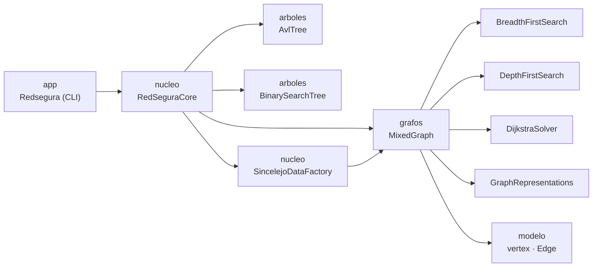
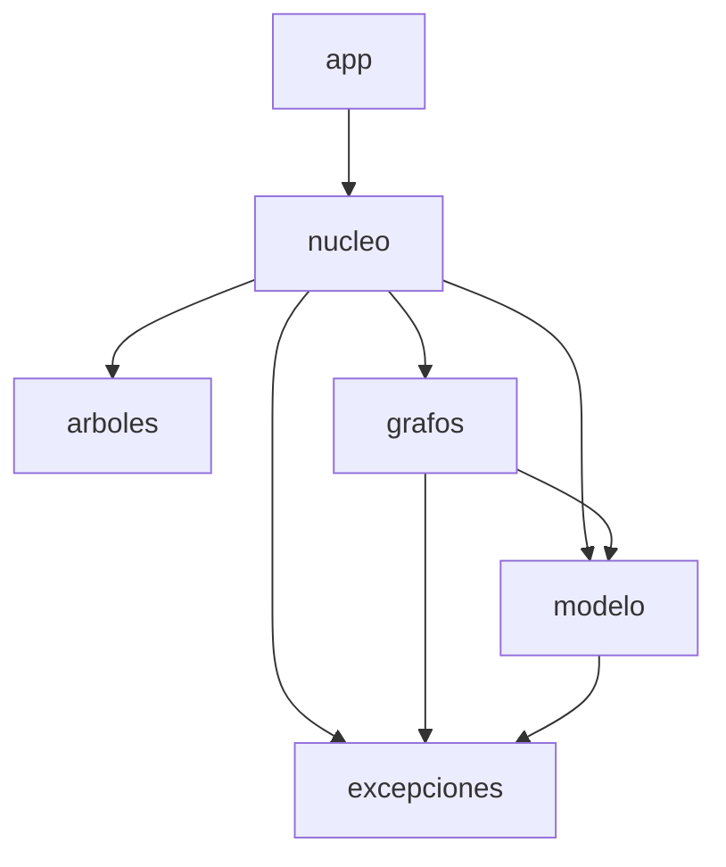
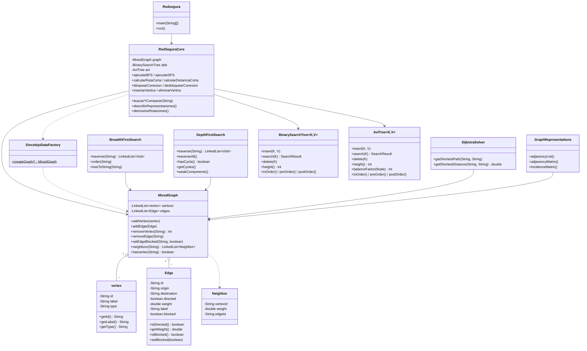
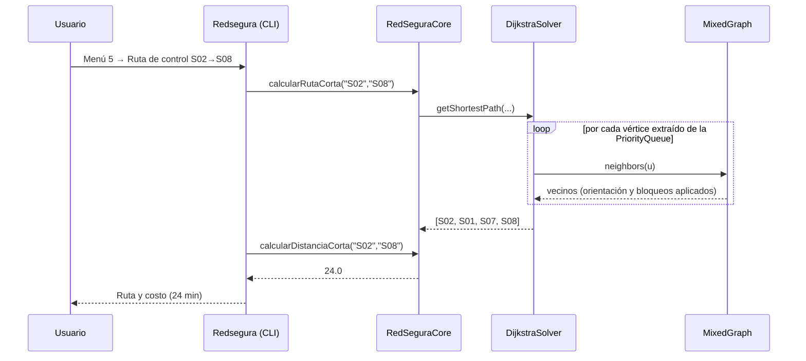

# RedSegura Sincelejo

**Árboles y grafos aplicados a una red de atención de emergencias** — Parcial 2 de Estructura de Datos II (2026).

Aplicación de consola en **Java 17 + Maven** que modela la movilidad entre universidades, centros de salud, nodos de transporte y puntos de encuentro de Sincelejo. Implementa desde cero (sin librerías que resuelvan el algoritmo):

- Árbol binario de búsqueda (**ABB**) y árbol **AVL** con las cuatro rotaciones (LL, RR, LR, RL).
- **Grafo mixto** (aristas no dirigidas y arcos dirigidos), etiquetado y ponderado.
- Tres representaciones: **lista de adyacencia**, **matriz de adyacencia ponderada** y **matriz de incidencia**.
- Recorridos **BFS** (con cola) y **DFS** (recursivo, con detección de ciclos y componentes débiles).
- Ruta mínima con **Dijkstra** (`PriorityQueue`, relajación, predecesores y reconstrucción del camino).

> Los tiempos del grafo son datos didácticos de simulación; no constituyen información oficial de tránsito ni de respuesta a emergencias.

| | |
|---|---|
| **Autor** | Juan Herrera |
| **Docente** | Jaider Enrique Reyes Herazo |
| **Modalidad** | Individual |
| **Tecnología** | Java 17 · Maven · Apache NetBeans · JUnit 5 |

---

## Contenido

1. [Requisitos](#requisitos)
2. [Compilar, probar y ejecutar](#compilar-probar-y-ejecutar)
3. [Estructura del proyecto](#estructura-del-proyecto)
4. [Arquitectura](#arquitectura)
5. [Datos: 12 lugares y 18 conexiones](#datos-12-lugares-y-18-conexiones)
6. [Uso: menú de consola](#uso-menú-de-consola)
7. [Consultas obligatorias Q1–Q7](#consultas-obligatorias-q1q7)
8. [Complejidad](#complejidad)
9. [Pruebas](#pruebas)
10. [Decisiones de diseño](#decisiones-de-diseño)
11. [Documentación adicional](#documentación-adicional)

---

## Requisitos

- **JDK 17** o superior.
- **Maven 3.8+** (o el Maven integrado de Apache NetBeans).
- Conexión a internet la primera vez, para descargar JUnit 5 y los plugins de Maven.

```bash
java -version    # debe mostrar 17 o superior
mvn -version
```

## Compilar, probar y ejecutar

Desde un clon limpio:

```bash
git clone https://github.com/JuanHerrera28/Parcial-Estructuras-de-datos-II.git
cd Parcial-Estructuras-de-datos-II

mvn clean package        # compila y ejecuta las pruebas JUnit
mvn test                 # solo pruebas

# ejecutar la aplicación (clase principal: co.edu.redsegura.app.Redsegura)
mvn exec:java -Dexec.mainClass=co.edu.redsegura.app.Redsegura
# o bien, con el JAR generado:
java -cp target/redsegura-1.0-SNAPSHOT.jar co.edu.redsegura.app.Redsegura
```

**Desde Apache NetBeans:** `File → Open Project`, seleccionar la carpeta del proyecto y pulsar *Run* (F6). La clase principal ya está configurada en el `pom.xml` (`exec.mainClass`).

## Estructura del proyecto

```
.
├── pom.xml
├── README.md
├── docs/
│   ├── ARQUITECTURA.md     diagramas de paquetes y clases, flujo de integración
│   ├── COMPLEJIDAD.md      análisis Big O (tiempo y espacio) y medición reproducible
│   ├── INFORME.md          decisiones, resultados de control y evidencia de Q1–Q7
│   └── PRUEBAS.md          inventario de pruebas JUnit y cómo ejecutarlas
└── src
    ├── main/java/co/edu/redsegura/
    │   ├── app/            Redsegura               menú de consola (CLI)
    │   ├── nucleo/         RedSeguraCore           fachada que integra árboles y grafo
    │   │                   SincelejoDataFactory    fábrica con el conjunto de datos del parcial
    │   ├── modelo/         vertex, Edge            modelo de datos con validaciones
    │   ├── arboles/        BinarySearchTree, AvlTree
    │   ├── grafos/         MixedGraph, Neighbor, GraphRepresentations,
    │   │                   BreadthFirstSearch, DepthFirstSearch, DijkstraSolver
    │   └── excepciones/    DuplicateIdException, InvalidWeightException, VertexNotFoundException
    └── test/java/co/edu/redsegura/pruebas/
                            TreesTest, MixedGraphTest
```

## Arquitectura



`Redsegura` (interfaz) **solo habla con `RedSeguraCore`**. `RedSeguraCore` usa `AvlTree`, `BinarySearchTree` y `MixedGraph`, y el grafo es la base de BFS, DFS, Dijkstra y las representaciones.# Arquitectura de RedSegura

## 1. Vista general

RedSegura es una aplicación de consola organizada en cinco paquetes bajo `co.edu.redsegura`:

| Paquete | Responsabilidad |
|---|---|
| `app` | Interfaz de usuario (menús, lectura de teclado, impresión). No contiene lógica de negocio. |
| `nucleo` | `RedSeguraCore`: fachada que integra árboles y grafo. `SincelejoDataFactory`: crea el conjunto de datos del parcial. |
| `modelo` | Datos básicos: `vertex` (lugar) y `Edge` (conexión) con sus validaciones. |
| `arboles` | `BinarySearchTree` (ABB) y `AvlTree`, genéricos `<K extends Comparable<K>, V>`. |
| `grafos` | `MixedGraph` y los algoritmos que operan sobre él: `BreadthFirstSearch`, `DepthFirstSearch`, `DijkstraSolver`, `GraphRepresentations`; más `Neighbor`. |
| `excepciones` | `DuplicateIdException`, `InvalidWeightException`, `VertexNotFoundException`. |

## 2. Dependencias entre paquetes



Reglas de la integración (contrato del parcial):

- `app` **solo** depende de `nucleo` en la práctica: toda operación pasa por `RedSeguraCore`.
- `RedSeguraCore` usa `AvlTree`, `BinarySearchTree` y `MixedGraph`.
- El grafo provee BFS, DFS, Dijkstra y las representaciones. Cada algoritmo recibe el `MixedGraph` por constructor.
- Ningún módulo accede a campos privados de otro; solo se usan métodos públicos.

## 3. Diagrama de clases



## 4. Responsabilidades clave

### Modelo
- `vertex(id, label, type)`: inmutable; rechaza campos nulos o vacíos (`IllegalArgumentException`).
- `Edge(id, origin, destination, directed, weight, label)`: inmutable salvo el indicador `blocked`. Rechaza IDs vacíos y pesos ≤ 0, NaN o infinitos (`InvalidWeightException`).

### MixedGraph
- Guarda vértices y conexiones en `LinkedList` privadas y entrega **copias** (`getvertices()`, `getEdges()`), de modo que nadie puede modificar el estado interno desde fuera.
- Valida IDs duplicados (`DuplicateIdException`) y extremos inexistentes (`VertexNotFoundException`) antes de modificar nada.
- `neighbors(id)` es el **único punto donde se aplica la orientación y el bloqueo**:

  | Conexión | ¿Aparece como vecino de…? |
  |---|---|
  | Dirigida A → B | solo de A |
  | No dirigida A — B | de A y de B |
  | Bloqueada | de ninguno |

### Algoritmos
- **BFS**: cola (`Queue<Visit>` sobre `LinkedList`) + lista de visitados. Cada `Visit` guarda vértice, padre y nivel → se imprime como árbol BFS.
- **DFS**: recursivo. Mantiene dos listas, *en proceso* y *terminados*; un vecino *en proceso* implica ciclo. Registra tiempos de descubrimiento/finalización. `weakComponents()` ignora la orientación.
- **Dijkstra**: `PriorityQueue<NodeRecord>` ordenada por distancia; tabla de rutas (`distancia`, `previo`) con relajación; el camino se reconstruye siguiendo los predecesores desde el destino. Si el destino es inalcanzable devuelve una lista vacía (y distancia `∞`).
- **GraphRepresentations**: las tres vistas se construyen con el mismo orden de vértices y de conexiones (el de inserción), por eso coinciden entre sí.

### Árboles
- **ABB**: inserción, búsqueda (cuenta los pasos), eliminación (sucesor in-order), altura y tres recorridos.
- **AVL**: añade `height` por nodo, factor de balance y `balance()` que aplica LL, RR, LR o RL tras cada inserción y eliminación.

## 5. Flujo de una consulta (ejemplo Q5)



## 6. Manejo de errores

Las tres excepciones propias heredan de `RuntimeException`. La interfaz envuelve cada opción de menú en un `try/catch (RuntimeException)`, imprime `Error: <mensaje>` y vuelve al menú: el programa nunca termina por un dato inválido (consulta Q7).

## 7. Sincronización grafo ↔ árboles

`RedSeguraCore.insertarVertice` valida primero en el grafo y solo si tiene éxito inserta la clave en ABB y AVL; `eliminarVertice` hace lo mismo en orden inverso. Así, una excepción nunca deja los tres en estados distintos.


## Datos: 12 lugares y 18 conexiones

La clase `SincelejoDataFactory` crea el grafo con los datos originales del parcial.

| ID | Lugar | Tipo | | ID | Lugar | Tipo |
|---|---|---|---|---|---|---|
| S01 | UAJS Sede C | Universidad | | S07 | Estación Central SETP | Transporte |
| S02 | UAJS Sede E | Universidad | | S08 | Terminal de Transporte | Transporte |
| S03 | Universidad de Sucre | Universidad | | S09 | Parque Santander | Punto de encuentro |
| S04 | CECAR | Universidad | | S10 | Mercado de Sincelejo | Comercio |
| S05 | Hospital Universitario | Salud | | S11 | PEP Argelia | Paradero |
| S06 | Clínica Las Américas | Salud | | S12 | Glorieta Sincelejito | Movilidad |

| ID | Origen | Destino | Tipo | Min | Etiqueta |
|---|---|---|---|---|---|
| R01 | S01 | S07 | Dirigida | 4 | Corredor universitario |
| R02 | S07 | S01 | Dirigida | 6 | Retorno por vía alterna |
| R03 | S01 | S09 | No dirigida | 5 | Corredor peatonal |
| R04 | S02 | S01 | No dirigida | 8 | Conexión entre sedes |
| R05 | S02 | S06 | Dirigida | 10 | Ruta de atención |
| R06 | S06 | S05 | Dirigida | 4 | Corredor clínico |
| R07 | S05 | S09 | No dirigida | 6 | Vía hospitalaria |
| R08 | S09 | S10 | No dirigida | 3 | Centro histórico |
| R09 | S10 | S08 | Dirigida | 8 | Salida al terminal |
| R10 | S08 | S10 | Dirigida | 9 | Ingreso desde terminal |
| R11 | S03 | S12 | No dirigida | 4 | Corredor Puerta Roja |
| R12 | S12 | S09 | No dirigida | 7 | Troncal al centro |
| R13 | S04 | S11 | No dirigida | 6 | Conexión universitaria |
| R14 | S11 | S07 | Dirigida | 8 | Ruta SETP al centro |
| R15 | S07 | S09 | No dirigida | 3 | Transferencia central |
| R16 | S07 | S08 | Dirigida | 12 | Ruta SETP al terminal |
| R17 | S09 | S03 | Dirigida | 7 | Ruta hacia universidad |
| R18 | S12 | S04 | Dirigida | 9 | Ruta hacia CECAR |

## Uso: menú de consola

```
==========================================
      REDSEGURA - MENU PRINCIPAL
==========================================
1. Gestion del Grafo              listar / insertar / eliminar vértices y conexiones, vecinos
2. Gestion de Arboles (ABB y AVL) recorridos, insertar, eliminar, buscar, alturas, rotaciones
3. Representaciones del Grafo     lista, matriz de adyacencia y matriz de incidencia
4. Recorridos (BFS y DFS)         BFS, DFS, ¿hay ciclos?, componentes débiles
5. Ruta Minima (Dijkstra)         ruta entre dos vértices, ruta de control, bloquear/desbloquear
6. Consultas Obligatorias (Q1-Q7)
7. Salir
```

Cualquier error (ID inexistente, duplicado, peso inválido, opción no válida) se muestra como `Error: …` y **el programa continúa**.

Al insertar o eliminar un vértice desde *Gestión del Grafo*, el cambio se aplica a la vez en el grafo, el ABB y el AVL, para que los tres se mantengan sincronizados.

## Consultas obligatorias Q1–Q7

Se ejecutan desde el menú **6**. Resultados reales con los datos originales:

| Consulta | Resultado |
|---|---|
| **Q1** Buscar *Hospital Universitario* (S05) en ABB y AVL | ABB: **5** pasos (altura 12) · AVL: **4** pasos (altura 4) |
| **Q2** Cuatro rotaciones AVL | LL `30,20,10` · RR `10,20,30` · LR `30,10,20` · RL `10,30,20` → en los cuatro casos queda `preOrder [20, 10, 30]` con altura 2 |
| **Q3** Lista, matriz de adyacencia y matriz de incidencia | Tres representaciones con el mismo orden de vértices (S01…S12) y de conexiones (R01…R18) |
| **Q4** BFS y DFS desde S02 | BFS: `S02, S01, S06, S07, S09, S05, S08, S10, S12, S03, S04, S11` · DFS: `S02, S01, S07, S09, S05, S10, S08, S12, S03, S04, S11, S06` |
| **Q5** Dijkstra S02 → S08 | `[S02, S01, S07, S08]` = **24 min** ✔ (valor de control) |
| **Q6** Bloquear R16 y recalcular | Ruta `[S02, S01, S09, S10, S08]` = **24 min**: el camino cambia, el costo no |
| **Q7** Vértice inexistente (`S99`) | `Error controlado: El vertice no existe: S99 (el programa continua)` |

**¿Por qué difieren BFS y DFS (Q4)?** BFS usa una cola y visita por niveles: primero todos los vecinos de S02 (S01, S06), luego los de ellos, y así sucesivamente. DFS se hunde por una rama hasta agotarla (S02 → S01 → S07 → S09 → …) y recién después vuelve y explora lo que quedó pendiente (S06 queda de último).

**¿Por qué el costo no cambia en Q6?** Al bloquear R16 (S07 → S08, 12 min) se pierde la ruta `S02-S01-S07-S08` (8 + 4 + 12 = 24), pero existe una alternativa por el centro: `S02-S01-S09-S10-S08` (8 + 5 + 3 + 8 = 24). Empatan en 24 minutos.

## Complejidad

Resumen (V = vértices, E = conexiones, n = claves, h = altura del árbol). La tabla completa, con la justificación y la comparación con una implementación basada en `HashSet`/lista de adyacencia, está en [docs/COMPLEJIDAD.md](docs/COMPLEJIDAD.md).

| Estructura / algoritmo | Tiempo | Espacio |
|---|---|---|
| ABB insertar / buscar / eliminar | O(h) → O(n) peor caso, O(log n) promedio | O(n) |
| AVL insertar / buscar / eliminar | **O(log n)** garantizado | O(n) |
| Recorridos de árbol, `inOrder` / `preOrder` / `postOrder` | O(n) | O(n) |
| `MixedGraph.neighbors(id)` | O(V + E) | O(grado) |
| Lista de adyacencia | O(V · E) | O(V + E) |
| Matriz de adyacencia | O(V² + E · V) | O(V²) |
| Matriz de incidencia | O(V · E) | O(V · E) |
| BFS | O(V · (V + E)) | O(V) |
| DFS | O(V · (V + E)) | O(V) |
| Dijkstra | O(V · (V + E) + E log E) | O(V + E) |

Los factores adicionales de V frente al óptimo teórico (O(V + E) en BFS/DFS y O((V + E) log V) en Dijkstra) provienen de usar `LinkedList` como estructura de visitados y de buscar vecinos recorriendo la lista de conexiones. Es una decisión consciente, explicada en [Decisiones de diseño](#decisiones-de-diseño); con V = 12 y E = 18 el costo es despreciable.

## Pruebas

JUnit 5 — **25 pruebas** en dos clases:

| Clase | Pruebas | Cubre |
|---|---|---|
| `TreesTest` | 12 | ABB (recorridos, altura, búsqueda con conteo de pasos, eliminación con dos hijos, degeneración a lista), AVL (rotaciones LL/RR/LR/RL, balance con claves ordenadas, eliminación, comparación de alturas), claves nulas |
| `MixedGraphTest` | 13 | Conjunto de datos (12 + 18), orientación de arcos y aristas, bloqueo, eliminar vértice/conexión, vértice inexistente, IDs duplicados, pesos inválidos (0, negativo, NaN, ∞), IDs vacíos y nulos |

```bash
mvn test
```

Detalle y evidencia de ejecución en [docs/PRUEBAS.md](docs/PRUEBAS.md).

## Decisiones de diseño

- **Estructuras propias, sin librerías de algoritmos.** AVL, BFS, DFS y Dijkstra están escritos desde cero. De la librería estándar solo se usan contenedores: `LinkedList`, `Queue` y `PriorityQueue`.
- **`LinkedList` como estructura base.** El grafo guarda vértices y conexiones en listas enlazadas que conservan el **orden de inserción**; ese orden es el que comparten las tres representaciones, de modo que las matrices y la lista siempre coinciden.
- **Orientación en un solo lugar.** `MixedGraph.neighbors(id)` decide qué conexiones se pueden usar desde un vértice (dirigida: solo origen → destino; no dirigida: ambos sentidos; bloqueada: se ignora). BFS, DFS y Dijkstra consumen ese método y por eso respetan la orientación y los bloqueos sin repetir lógica.
- **Bloquear no es borrar.** `Edge.setBlocked(true)` desactiva una conexión sin eliminarla, lo que permite Q6 y volver al estado original. `removeEdge` sí la elimina definitivamente. Las representaciones (lista y matrices) muestran la estructura completa, incluidas las bloqueadas.
- **Validaciones en el constructor.** `Edge` y `vertex` rechazan IDs vacíos o nulos; `Edge` rechaza pesos ≤ 0, NaN e infinitos con `InvalidWeightException`. `MixedGraph` lanza `DuplicateIdException` y `VertexNotFoundException`.
- **Excepciones propias de tipo `RuntimeException`.** La CLI las captura en un solo punto, muestra el mensaje y sigue funcionando (Q7).
- **Fachada `RedSeguraCore`.** Es el único contrato entre la interfaz y el resto; mantiene sincronizados el grafo y los dos árboles al insertar o eliminar vértices.
- **AVL: caso de empate de factor de balance.** Se trata como LL/RR simple (`>= 0` a la izquierda, `<= 0` a la derecha), que es lo correcto en eliminaciones.

## Documentación adicional

| Documento | Contenido |
|---|---|
| [docs/ARQUITECTURA.md](docs/ARQUITECTURA.md) | Diagramas de dependencias y de clases, responsabilidades, contrato de integración |
| [docs/COMPLEJIDAD.md](docs/COMPLEJIDAD.md) | Análisis Big O de cada componente y medición breve reproducible ABB vs AVL |
| [docs/INFORME.md](docs/INFORME.md) | Informe breve: decisiones, resultados de control y evidencia de las consultas |
| [docs/PRUEBAS.md](docs/PRUEBAS.md) | Inventario de pruebas, ejecución y evidencia |

## Originalidad

Proyecto individual. El historial de commits refleja el desarrollo progresivo de cada componente (modelo → grafo → representaciones → BFS/DFS → Dijkstra → AVL → integración).
